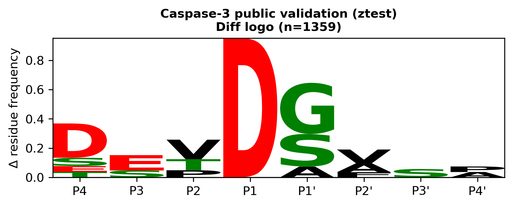
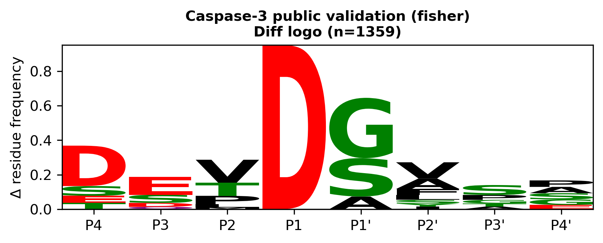

# pydaglogo

Background-aware amino-acid enrichment analysis and sequence logos in Python.
Compare residue usage around aligned sites with sampled background windows,
using a z-test or Fisher's exact test, and visualize the resulting differences.

| z-test | Fisher test |
| --- | --- |
|  |  |

The previews use the included public CaspSites Caspase-3 benchmark.

## Install

Requires Python 3.10 or newer.

```bash
python -m pip install "git+https://github.com/mmmddd98/pydaglogo.git"
```

## Quick start

```python
import pandas as pd
from pydaglogo import make_daglogo, prepare_proteome

sites = pd.read_csv("inputs/sites.csv")
proteome = prepare_proteome("inputs/proteome.fasta")
result, ax, matrix = make_daglogo(
    sites, proteome=proteome, input_mode="positions", test_type="ztest",
    labels=["P4", "P3", "P2", "P1", "P1'", "P2'", "P3'", "P4'"],
)
```

The input table contains residue columns `P4` through `P4'`. For flank columns,
use `input_mode="flanks"`; `run_daglogo` performs the analysis without plotting.
See [input formats and background models](docs/details.md#input-styles) and
the [API reference](docs/api.rst).

## Examples and validation

From a source checkout:

```bash
git clone https://github.com/mmmddd98/pydaglogo.git
cd pydaglogo
python -m pip install -e '.[dev]'
python examples/demo_flanks_oneshot_ztest.py
python -m pytest
```

Examples use the committed reference data. [Validation instructions](docs/details.md#public-benchmark)
compare results with R `dagLogo` references for the shipped benchmark; this
does not establish equivalence for every input. Exact R-backed Fisher parity
requires a working `Rscript`. Without it, Fisher testing uses SciPy's
conditional odds-ratio implementation, which can differ slightly from R.

## Attribution and license

A Python reimplementation and adaptation of
[R/Bioconductor dagLogo](https://bioconductor.org/packages/dagLogo/).
Original Python package: [ibex-001/pydaglogo](https://github.com/ibex-001/pydaglogo),
by Markus Kramer. Distributed under
[GPL-2.0](LICENSE); retain the original notices.

Please cite Ou et al. (2020), *dagLogo: An R/Bioconductor package for identifying
and visualizing differential amino acid group usage in proteomics data*,
[doi:10.1371/journal.pone.0242030](https://doi.org/10.1371/journal.pone.0242030).
